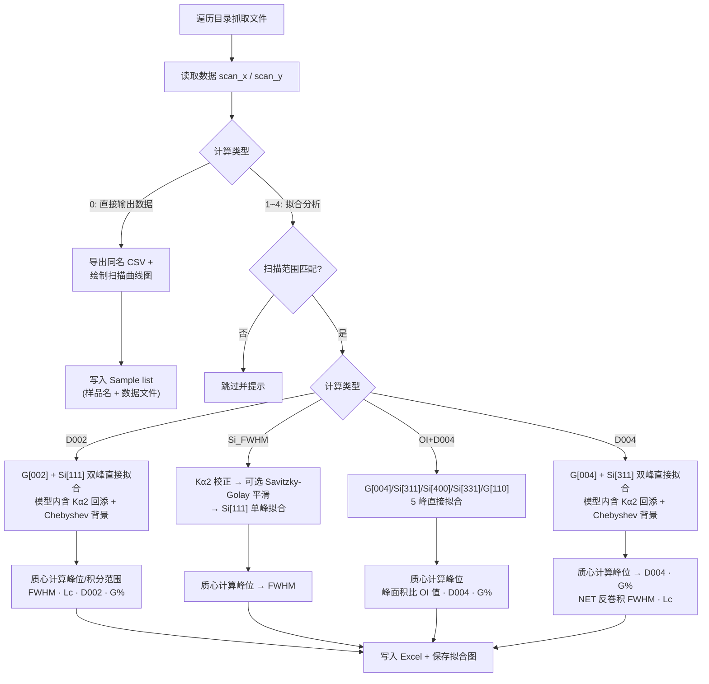

# Py-XRD-D002
## Introduction
XRD衍射数据自动分析
## Usage
运行 `main.py` 后按提示依次选择，程序会遍历当前目录（含子目录）下所有匹配的文件：

1. 选择文件类型
    1. `.rd` (Philips RD 文件，适用于 V3 设备，其余设备可能需要修改对应偏移量)
    2. `.xrdml` (帕纳科 XRD 文件，不同设备版本可能需要修改 `data_reader.py` 中对应 xml 元素)
    3. `.raw` (日本理学 XRD 文件)
    4. `.raw` (布鲁克 Bruker RAW V4 文件，要求文件头为 `RAW4.00`)
2. 选择计算类型
    0. 直接输出数据 (不做拟合，将扫描数据导出为同名 CSV 并绘图)
    1. D002 (石墨 D002 —— 石墨[002] + 硅[111] 双峰)
    2. Si_FWHM (纳米硅 FWHM —— 硅[111] 单峰)
    3. OI+D004 (石墨 OI 值 —— [004]/[110] 强度比 + [004] 层间距)
    4. D004 (石墨 D004 层间距 —— 石墨[004] + 硅[311] 双峰)
3. 选择是否平滑数据（仅 Si_FWHM 模块询问，Savitzky-Golay 平滑后拟合）
    1. Yes
    2. No
4. 选择是否输出拟合结果（仅计算类型 1~4 询问，为每个样品生成独立 Excel 工作表与拟合图）
    1. Yes
    2. No
5. 选择是否裁切文件名（仅输出拟合结果时询问，取文件名倒数第 3 段作为工作表名）
    1. Yes
    2. No

选择计算类型 0 时不涉及拟合，因此不会询问第 4、5 项：程序直接把扫描数据输出为与源文件同名的 CSV，并绘制扫描曲线图。

计算类型 1~4 会根据所选模块的峰位区间自动过滤扫描范围不匹配的文件（D002 需覆盖 26.5°–28.4°，Si_FWHM 需覆盖 28.4°，OI+D004 需覆盖 54.5°–77°，D004 需覆盖 54.5°–56.1°），不匹配的文件将被跳过并提示；计算类型 0 不做范围过滤。全部处理完成后，结果汇总写入当前目录下的 `xrd_processed.xlsx`。

## Data Processing Flow
程序对每个匹配文件依次执行「读取 → 过滤（计算类型 1~4）→ 分析 → 输出」，整体流程如下：

### 1. 数据读取与范围过滤
- 按所选文件类型由 `data_reader.py` 解析为 2θ 角度数组 `scan_x` 与强度数组 `scan_y`（`.rd` / `.xrdml` / 日本理学 `.raw` / 布鲁克 `.raw`（RAW4.00）四种格式）。
- 计算类型 1~4 按计算模块所需峰位区间过滤文件，范围不匹配的直接跳过并提示，避免不同扫描范围的数据混用导致拟合失败；计算类型 0 不做过滤。

### 2. 直接输出数据（计算类型 0）
不做峰值拟合，只做数据导出与展示：
1. 按所选文件类型读取 2θ 角度与强度数组，不限制扫描范围（任意扫描范围的数据均可输出）。
2. 将扫描数据写入与源文件同名的 CSV（保存在源文件同级目录），表头为 `2-Theta (deg),Intensity (A.U.)`，角度保留 6 位小数、强度保留 4 位小数。
3. 复用统一绘图模块 `render_plot` 绘制原始扫描曲线，保存为源文件同级的 `{sample_name}_plot.png`（300 dpi，标题/坐标轴/网格/图例样式与拟合图一致）。

### 3. D002（石墨 [002] + 硅 [111] 内标双峰）
1. **直接拟合原始数据**：模型 `double_peak_raw` = 石墨 [002]（~26.5°）与硅 [111]（~28.4°）两个 Split-Pearson VII 峰 + 二阶 Chebyshev 背景，并在模型内部通过 `decorrect_ka2` 回添 Kα2 双线成分，因此无需预先校正即可拟合原始谱。
2. 由拟合参数重建各净峰曲线，用 IUCr 重心法（对称窗口内迭代质心）计算峰位及积分范围。
3. 以硅 [111] 内标校正峰位计算 D002 层间距：$d_{002}=\dfrac{\lambda}{2\sin\theta}$，其中 $\theta$ 为校正后石墨峰位的半角。
4. 石墨化度：$G\% = 100 \times \dfrac{3.440 - d_{002}}{3.440 - 3.354}$。
5. 半峰宽：
   - **实测值**：Split-Pearson VII 半峰宽数值求解；
   - **NET**：将硅峰与洛伦兹函数卷积拟合石墨峰进行反卷积，得到石墨净半峰宽；
   - **JIS**：按 JIS R 7651:2007 以硅 [111] 与石墨 [002] 半峰宽比值校正。
6. 由各 FWHM 按 Scherrer 公式计算 Lc 值。
7. 输出拟合结果时，用 `correct_ka2` 迭代法生成 Kα2 校正强度曲线用于绘图。

### 4. Si_FWHM（纳米硅 [111] 单峰）
1. 先用 `correct_ka2` 做迭代 Kα2 校正。
2. 可选 Savitzky-Golay（窗口 25、3 阶）平滑后再拟合。
3. 拟合 `single_peak`：硅 [111] Split-Pearson VII 峰 + Chebyshev 背景。
4. 重心法计算峰位，数值求解半峰宽 FWHM。

### 5. OI+D004（石墨 [004]/[110] 强度比 + 层间距）
1. **直接拟合原始数据**：模型 `oi_peak_raw` = 石墨 [004]（~54.2°）、硅 [311]（~56.1°）、硅 [400]（~69.1°）、硅 [331]（~76.4°）、石墨 [110]（~77.6°）五个 Split-Pearson VII 峰 + Chebyshev 背景，模型内含 Kα2 回添。
2. 重心法计算各峰位与积分范围；OI 值 = [004] 峰面积 / [110] 峰面积（梯形积分）。
3. 以硅 [311] 内标校正峰位计算 D004 层间距（$d_{004}=2 \times \dfrac{\lambda}{2\sin\theta}$），并换算石墨化度 G%。

### 6. D004（石墨 [004] + 硅 [311] 内标双峰）
1. **直接拟合原始数据**：模型 `double_peak_raw` = 石墨 [004]（~54.6°）与硅 [311]（~56.1°）两个 Split-Pearson VII 峰 + 二阶 Chebyshev 背景，模型内含 Kα2 回添，适用于约 52°~58° 的扫描范围。
2. 重心法计算两峰峰位与积分范围；以硅 [311] 内标校正后的石墨 [004] 峰位计算 D004 层间距（$d_{004}=2 \times \dfrac{\lambda}{2\sin\theta}$，×2 便于与 D002 对比），并换算石墨化度 G%。
3. 半峰宽：实测值由 Split-Pearson VII 数值求解；NET 值以硅 [311] 峰形为仪器函数、对石墨峰做卷积反解得到；由 NET 半峰宽按 Scherrer 公式计算 Lc 值。

### 7. 结果输出
- 汇总表 `Sample list` 写入 `xrd_processed.xlsx`；选择输出拟合结果时，另为每个样品创建独立工作表（原始强度、Kα2 校正强度、拟合曲线、背景及各净峰）。
- 在源文件同级目录保存 `{sample_name}_plot.png` 拟合图（含各分峰曲线与峰位质心标注线）。
- 计算类型 0 不创建样品工作表，汇总表仅记录样品名与输出数据文件路径（`Data File` 列），扫描数据以同名 CSV 保存在源文件同级目录。

## Output
输出文件 `xrd_processed.xlsx` 包含一个 `Sample list` 汇总表；选择输出拟合结果时，还会为每个样品创建独立的拟合结果工作表（原始强度、Kα2 校正强度、拟合曲线、背景及各分峰）。

- 计算类型 1、3、4（D002 / OI+D004 / D004）在源文件所在目录保存 `{sample_name}_plot.png` 拟合图；计算类型 2（Si_FWHM）只输出数据表，不生成图片。
- 计算类型 0（直接输出数据）不创建样品工作表：每个样品输出同名 CSV（与源文件同级，两列 `2-Theta (deg),Intensity (A.U.)`）与 `{sample_name}_plot.png` 扫描曲线图，汇总表 `Sample list` 记录样品名与 `Data File` 路径。

### 石墨+硅内标样：测定石墨材料 D002 层间距

    1. D002 (Å) -- 石墨[002]层间距
    2. G% -- 石墨化度
    3. Graphite [002] Peak (deg) -- 石墨[002]峰位（拟合曲线质心）
    4. Graphite [002] Int. Range (deg) -- 石墨[002]质心积分范围
    5. Graphite [002] FWHM (deg) -- 石墨[002]半峰宽 (实测值)
    6. Silicon [111] Peak (deg) -- 硅[111]峰位（拟合曲线质心）
    7. Silicon [111] Int. Range (deg) -- 硅[111]质心积分范围
    8. Silicon [111] FWHM (deg) -- 硅[111]半峰宽 (实测值)
    9. Graphite [002] FWHM NET.(deg) -- 石墨[002]半峰宽 (反卷积数值计算)
    10.Graphite [002] Lc NET.(Å) -- 石墨[002]Lc值 (反卷积数值计算)
    11.Graphite [002] FWHM JIS(deg) -- 石墨[002]半峰宽 (依据JIS R 7651:2007)
    12.Graphite [002] Lc JIS(Å) -- 石墨[002]Lc值 (依据JIS R 7651:2007)

### 纳米硅：测定硅[111]晶向晶粒尺寸

    1. Silicon [111] Peak (deg) -- 硅[111]峰位（拟合曲线质心）
    2. Silicon [111] FWHM (deg) -- 硅[111]半峰宽 (实测值)

### 石墨：测定 OI 值（[004]强度/[110]强度）与 D004 层间距

    1. Graphite OI value (-) -- 石墨OI值(I004/I110)
    2. Dual D004 (Å) -- 石墨[004]层间距
    3. G% -- 石墨化度
    4. Graphite [004] Peak (deg) -- 石墨[004]峰位（拟合曲线质心）
    5. Graphite [004] Int. Range (deg) -- 石墨[004]质心积分范围
    6. Graphite [004] Intensity (counts) -- 石墨[004]峰强
    7. Graphite [004] FWHM (deg) -- 石墨[004]半峰宽
    8. Graphite [110] Peak (deg) -- 石墨[110]峰位（拟合曲线质心）
    9. Graphite [110] Int. Range (deg) -- 石墨[110]质心积分范围
    10.Graphite [110] Intensity (counts) -- 石墨[110]峰强
    11.Graphite [110] FWHM (deg) -- 石墨[110]半峰宽

### 石墨+硅内标样：测定石墨材料 D004 层间距（约 52°~58° 扫描）

    1. Dual D004 (Å) -- 石墨[004]层间距（×2，便于与 D002 对比）
    2. G% -- 石墨化度
    3. Graphite [004] Peak (deg) -- 石墨[004]峰位（拟合曲线质心）
    4. Graphite [004] Int. Range (deg) -- 石墨[004]质心积分范围
    5. Graphite [004] Intensity (counts) -- 石墨[004]峰强
    6. Graphite [004] FWHM (deg) -- 石墨[004]半峰宽 (实测值)
    7. Graphite [004] FWHM NET.(deg) -- 石墨[004]半峰宽 (反卷积数值计算)
    8. Graphite [004] Lc NET.(Å) -- 石墨[004]Lc值 (反卷积数值计算)
    9. Silicon [311] Peak (deg) -- 硅[311]峰位（拟合曲线质心）
    10.Silicon [311] Int. Range (deg) -- 硅[311]质心积分范围
    11.Silicon [311] Intensity (counts) -- 硅[311]峰强
    12.Silicon [311] FWHM (deg) -- 硅[311]半峰宽

### 直接输出数据（计算类型 0）

    1. Sample Name -- 样品名
    2. Data File -- 输出数据文件路径（相对当前目录的同名 CSV）

## Project Structure
- `main.py` -- 程序入口：交互式选择、文件遍历与范围过滤、结果汇总；统一绘图模块 `render_plot` 与数据导出 `save_scan_csv`（计算类型 0 及各拟合模块共用）
- `data_reader.py` -- 数据读取模块：`.rd` / `.xrdml` / `.raw`（日本理学与布鲁克 RAW V4）格式解析
- `data_processor.py` -- 数据处理模块：Split-Pearson VII 分峰拟合、Kα2 校正、质心/FWHM/Lc 计算

## Credits
- 数据读取模块部分逻辑参考：[xylib](http://github.com/wojdyr/xylib/)
- 数据处理模块依赖于数值计算与数学库：[scipy](https://scipy.org/)、[numpy](https://numpy.org/)
- 数据可视化模块依赖于函数绘图库：[matplotlib](https://matplotlib.org/)
- 数据输出模块依赖于 excel 读写库：[openpyxl](https://openpyxl.readthedocs.io/)

## Reference
- [A Correction for the Alpha-1, Alpha-2 Doublet in tin Measurement of Width of X-ray Diffraction Lines](https://iopscience.iop.org/article/10.1088/0950-7671/25/7/125)
- [The Synthesis of X‐Ray Spectrometer Line Profiles with Application to Crystallite Size Measurements](https://doi.org/10.1063/1.1721595)
- [炭素材料の格子定数及び結晶子の大きさ測定方法 JIS R 7651:2007](https://kikakurui.com/r7/R7651-2007-01.html)
